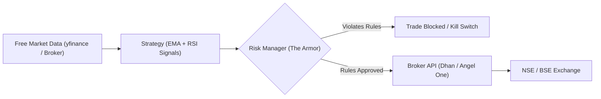

# 🇮🇳 Indian Stock Market Trading Bot: Zero-to-Live Roadmap
> **Tailored for:** Basic Python Experience  
> **Development Platform:** Google Antigravity IDE  
> **Target Market:** National Stock Exchange (NSE) / BSE  
> **Cost Model:** 100% Free / Affordable Tooling (Zero API Subscription Fees)  
> **Core Focus:** Ironclad Risk Controls, Realistic Backtesting & Micro-Capital Live Deployment  

---

## 🧭 Executive Summary: How an Algorithmic Trading Bot Works

In simple language, an algorithmic trading bot is just a disciplined computer assistant running in a continuous loop:
1. **Senses (Data Fetcher):** Checks the latest candle prices of your chosen stocks (e.g. Tata Motors, ITC).
2. **Thinks (Strategy):** Evaluates mathematical rules (e.g., "Has the 9 EMA crossed above the 21 EMA? Is RSI above 50?").
3. **Protects (Risk Manager):** Checks safety rules before risking real money ("Did I already lose ₹500 today? Am I taking too much risk? Is it past 2:45 PM?").
4. **Acts (Broker Execution):** Places the order directly on the exchange via your broker's API.



---

## 🛠️ The Affordable Toolstack (Why Pay ₹0 Instead of ₹30,000/yr?)

Many commercial algo software or big brokers charge high recurring fees (e.g., Zerodha charges ₹2,000/month for Kite Connect + ₹500/month for historical data = ₹30,000/year!). For a beginner with basic Python, this eats up capital before your first trade.

We use an **entirely free stack**:

| Tool / Component | Recommendation | Why It's Chosen | Cost |
| :--- | :--- | :--- | :--- |
| **Development Platform** | **Google Antigravity IDE** | Pair-programs with you, writes and audits code, runs terminals, catches bugs | **Free** |
| **Broker API (Live Orders)** | **DhanHQ API** *(or Angel One SmartAPI)* | Full Python SDK, automated order placement, zero API charges | **₹0 / Month** |
| **Historical & Intraday Data** | **`yfinance`** *(Yahoo Finance)* | Free 1-min, 5-min, 15-min, and daily candles for all NSE stocks (`.NS`) | **₹0** |
| **2FA / TOTP Login** | **`pyotp`** | Generates the mandatory SEBI 6-digit 2FA login code automatically | **₹0** |
| **Mobile Notifications** | **Telegram Bot API** | Pings your phone instantly on trade entries, exits, or kill-switch triggers | **₹0** |

---

## 🛡️ The 4 Cardinal Rules of Indian Market Algo-Trading

Before writing a single order execution line, you must understand these 4 realities of Indian retail trading:

1. **Transaction Costs Add Up:**  
   In India, every trade has fees: Brokerage (flat ₹20 per leg = ₹40 round trip) + STT (Securities Transaction Tax) + GST (18% on brokerage) + Stamp Duty + SEBI turnover fee. A single round trip trade costs around **₹45 to ₹50**.  
   *Rule: If your profit target on a trade is only ₹20, you will lose money even on a winning trade! The bot must only take trades where the expected gain comfortably exceeds ₹50.*
2. **Never Start in Futures & Options (F&O):**  
   SEBI reports that 93% of retail intraday F&O traders lose money due to theta decay and sudden volatility spikes.  
   *Rule: Start in the **Equity Cash Market (Intraday MIS or Delivery CNC)** on liquid Nifty 50 stocks (Tata Motors, INFY, ITC, ICICI Bank).*
3. **Mandatory Intraday Square-off Times:**  
   Brokers auto-square-off intraday MIS positions between 03:15 PM and 03:20 PM IST and charge a ₹50 penalty per position.  
   *Rule: The bot must automatically exit open intraday trades at 03:10 PM IST.*
4. **The Daily Kill Switch is Non-Negotiable:**  
   If your bot hits a predefined daily loss limit (e.g., -₹500), it must instantly lock itself down and refuse all further trades until tomorrow's market open.

---

## 🗺️ The 5-Phase Implementation Roadmap

---

### Phase 1: Environment Setup & Free Market Data Stream
**Goal:** Set up your Antigravity workspace, install the free libraries, and fetch live/historical prices for NSE stocks.

#### Step 1: Install Dependencies
Run in your Antigravity terminal:
```bash
pip install yfinance pandas numpy python-dotenv pyotp dhanhq
```

#### Step 2: What We Built in Your Workspace
- `config.py`: Controls watchlist, capital caps, and market hours.
- `src/data_fetcher.py`: Fetches clean 5-minute candles from NSE using `yfinance`.

#### 📋 Prompt to paste into Antigravity for Phase 1:
> *"Antigravity, let's test fetching the last 5 days of 5-minute candles for Tata Motors (TATAMOTORS.NS) and ITC (ITC.NS). Print the latest closing price and verify that the timestamps are converted to Indian Standard Time (IST)."*

---

### Phase 2: Strategy Design & Indicator Logic
**Goal:** Implement a simple, mathematically clear trend-following strategy without black-box machine learning.

#### Strategy Rules: 9/21 EMA Crossover + RSI Momentum Filter
- **Fast Line:** 9-period Exponential Moving Average (EMA).
- **Slow Line:** 21-period Exponential Moving Average (EMA).
- **Momentum Filter:** 14-period Relative Strength Index (RSI).
- **BUY Condition:** 9 EMA crosses above 21 EMA **AND** RSI > 50 (confirms upward momentum).
- **EXIT Condition:** 9 EMA crosses below 21 EMA **OR** RSI drops below 38.

#### What We Built in Your Workspace
- `src/strategy.py`: Implemented in pure `pandas` (no tricky C++ compilers like TA-Lib needed on Windows!).

#### 📋 Prompt to paste into Antigravity for Phase 2:
> *"Antigravity, review `src/strategy.py`. Can you add a function that plots the 9 EMA, 21 EMA, and buy/sell marker points on a 5-minute chart of TATAMOTORS using matplotlib so I can visually verify when the bot signals a trade?"*

---

### Phase 3: Realistic Backtesting & Cost Modeling
**Goal:** Verify whether your strategy actually made money over the past 30 to 60 days *after* paying Indian brokerage and taxes.

#### Why Backtesting is Prioritized
A strategy that looks profitable on paper often fails because of:
1. **Ignoring Brokerage/STT:** ₹45 per trade will wipe out small profits.
2. **Slippage:** The execution price might be slightly worse than the signal price.
3. **Drawdowns:** Can you tolerate a 5-trade losing streak without panic?

#### What We Built in Your Workspace
- `src/backtester.py`: Calculates Win Rate %, Profit Factor, Max Drawdown in Rupees, and Net PnL after ₹45 round-trip transaction costs.

To test it right now:
```bash
python main.py 1
```

#### 📋 Prompt to paste into Antigravity for Phase 3:
> *"Antigravity, run `src/backtester.py` across all stocks in `config.py` for the past 60 days. Show me a comparison table with Win Rate, Total Trades, Net Profit in INR, and Maximum Drawdown. Flag which stocks had negative returns after brokerage."*

---

### Phase 4: The Risk Management "Armor"
**Goal:** Build safety guardrails that protect your bank account even if the bot encounters a bug, internet loss, or market crash.

#### The 5 Pillars of Risk Protection in `src/risk_manager.py`:
1. **Hard Stop-Loss (1.0%):** Every single buy order immediately has an exit price calculated. If price falls 1%, it exits immediately.
2. **Fixed Take-Profit (2.0%):** Enforces a 1:2 Risk-Reward ratio (risk ₹10 to make ₹20).
3. **Daily Loss Kill-Switch (₹500 limit):** If cumulative losses today hit ₹500, the bot stops all trading for the day.
4. **Max 4 Trades Per Day:** Prevents the bot from entering high-frequency loops during choppy sideways markets.
5. **Auto-Square-Off at 03:10 PM:** Avoids the ₹50 broker intraday penalty.

#### 📋 Prompt to paste into Antigravity for Phase 4:
> *"Antigravity, simulate an edge case in `src/risk_manager.py` where 3 consecutive trades hit stop-loss resulting in a ₹550 loss. Verify that `can_open_new_trade()` returns False and the emergency kill switch triggers."*

---

### Phase 5: The "Micro-Capital" Live Deployment Bridge
**Goal:** Bridge the gap to live trading safely without risking substantial capital.

#### The Step-by-Step Transition Plan:

```
[ Step A: Paper Trading ] ──(Run for 3-5 days during market hours)──► Check logs & fills
           │
           ▼
[ Step B: Micro-Capital Live ] ──(Deploy with 1 SINGLE SHARE of a ₹200-₹500 stock)──►
           │                    Max possible risk per trade is only ~₹3 to ₹5!
           ▼
[ Step C: Controlled Scaling ] ──(After 30 live trades with verified profit factor > 1.3)──►
                                Gradually scale capital per trade to ₹5,000.
```

#### Setting Up Your Free DhanHQ Broker API:
1. Open a free Demat account on [Dhan.co](https://dhan.co/).
2. Log in to [Dhan Web](https://web.dhan.co/) -> Go to **Profile** -> **DhanHQ APIs**.
3. Generate your **Access Token** and copy your **Client ID**.
4. In your Antigravity workspace, copy `.env.example` to `.env`:
   ```bash
   cp .env.example .env
   ```
5. Paste your `DHAN_CLIENT_ID` and `DHAN_ACCESS_TOKEN` into `.env`.
6. Set `TRADING_MODE=LIVE` in `config.py` when you are ready to test with **1 share**.

#### 📋 Prompt to paste into Antigravity for Phase 5:
> *"Antigravity, let's configure `src/live_broker.py` for DhanHQ. Write a dry-run test script that fetches my available Demat margin and places a test intraday order for exactly 1 share of ITC.NS at market price, followed by an immediate stop-loss order."*

---

## 📂 Your Ready-to-Use Workspace Structure

```
c:\Trading Bot\
├── .env.example             # Template for confidential broker API keys
├── config.py                # Central controls: Watchlist, capital caps, risk limits
├── requirements.txt         # Free open-source Python dependencies
├── main.py                  # Main CLI launcher (Backtest / Paper / Live)
├── ROADMAP.md               # This complete guide
└── src\
    ├── data_fetcher.py      # Free yfinance intraday and daily quotes
    ├── strategy.py          # 9/21 EMA crossover + RSI indicator engine
    ├── risk_manager.py      # Kill-switch, position sizing, daily loss caps
    ├── backtester.py        # Indian equity backtester with brokerage modeling
    ├── paper_trader.py      # Zero-risk real-time live market simulation
    └── live_broker.py       # Live order transmitter (DhanHQ / Angel One)
```

---

## ⚡ Quickstart: What to Run Right Now in Antigravity

1. **Test Free Data Fetching:**
   ```bash
   python main.py 3
   ```
2. **Run Strategy Backtest on Historical Indian Data:**
   ```bash
   python main.py 1
   ```
3. **Run Safe Paper Trading (Real-Time Sim):**
   ```bash
   python main.py 2
   ```
